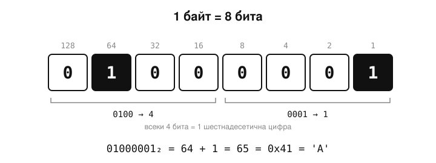
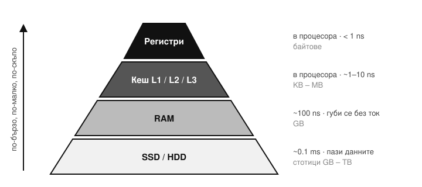
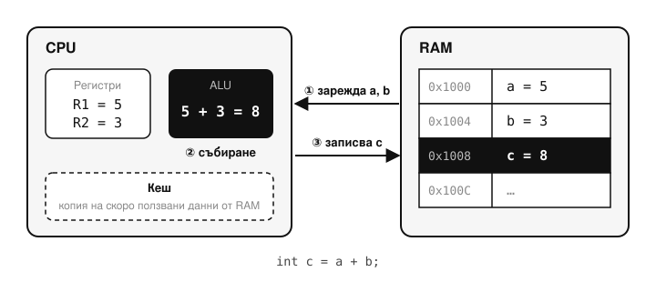

### 02/10/2026

---

### Основни принципи на програмирането

* Програмните езици служат като мост между човешката логика и машинния език, позволявайки описването на сложни задачи чрез математически и формални правила.


* За да бъде разбран и изпълнен от компютъра, програмният код преминава през процес на компилация. Този процес включва:


  * **Лексикален анализ**, при който кодът се разделя на основни съставни части.


  * **Синтактичен анализ**, който проверява дали кодът е написан според правилата (синтаксиса) на конкретния език.


  * **Семантичен анализ**, който следи за логическата последователност на кода.

> [!TIP]
> Как компилаторът „вижда“ реда `int x = 5 + 3;`
>
> | Етап | Какво проверява | Пример |
> |---|---|---|
> | Лексикален | Реже текста на думи (токени) | `int` · `x` · `=` · `5` · `+` · `3` · `;` |
> | Синтактичен | Граматиката на езика | `int x = 5 + ;` ✗ — липсва число след `+` |
> | Семантичен | Смисъла — типове, декларации | `int x = "здравей";` ✗ — граматически е наред, но текст не влиза в `int` |

> [!NOTE]
> Семантичният анализ проверява смисъла по правилата на езика (типове, дали променливата е декларирана). Грешки в самия алгоритъм — напр. `-` вместо `+` — компилаторът не може да хване. След анализите компилаторът **генерира** машинен код (при Java — байткод).


### Бройни системи

* Компютрите работят с **двоична бройна система**, която се състои само от нули и единици (битове).


* В програмирането често се използва и **шестнадесетична бройна система**, която освен цифрите от 0 до 9, включва и буквите от А до F, за по-удобно представяне на големи двоични числа.

> [!TIP]
> Едно и също число в трите системи:
>
> | Десетична | Двоична | Шестнадесетична |
> |---|---|---|
> | 5 | `101` | `5` |
> | 10 | `1010` | `A` |
> | 15 | `1111` | `F` |
> | 16 | `1 0000` | `10` |
> | 255 | `1111 1111` | `FF` |
>
> Двоично число → десетично: събираш степените на 2, където има единица. `1101` = 8 + 4 + 0 + 1 = **13**. Една шестнадесетична цифра е точно 4 бита, затова `1111 1111` се пише кратко `FF`. В Java може да пишеш директно: `int a = 0b1101;` (13) и `int b = 0xFF;` (255).


### Памет и кодиране на символи

* Компютърната памет се измерва в **битове и байтове**, като един байт се състои от 8 бита.




* За представянето на текстови символи се използват различни стандарти:
  * **ASCII** използва един байт и може да представи до 256 символа (основно латиница).


  * **Unicode** използва повече байтове (напр. два при Java), което позволява представянето на символи от много други езици, включително кирилица и китайски йероглифи.

> [!NOTE]
> Стандартният ASCII всъщност е **7-битов — 128 символа** (кодове 0–127). До 256 стигат т.нар. *разширени* ASCII таблици, където горните 128 символа зависят от кодовата таблица (напр. Windows-1251 за кирилица). Затова преди Unicode кирилицата често излизаше като „маймуняци“.

> [!TIP]
> В Java `char` е 2 байта (UTF-16), затова една буква на кирилица се побира в един `char`:
>
> ```java
> char c = 'Я';
> System.out.println((int) c);         // 1071 — кодът на 'Я' в Unicode
> System.out.println("😀".length());   // 2 — емоджитата не се побират в един char
> ```


### Компютърна архитектура

* **Процесорът (CPU)** е основният компонент, който изпълнява инструкциите.


* **Кеш паметта** е най-бързата памет, намираща се директно в процесора.

> [!NOTE]
> Още по-бързи от кеша са **регистрите** — няколко малки клетки вътре в процесора, с които той смята директно. Кешът (L1, L2, L3) е следващото ниво след тях.




* **RAM (оперативната памет)** е по-бавна, но служи за временно съхранение на данни, докато програмата се изпълнява. Данните в нея се губят при изключване на компютъра.


* За да се извърши дадена операция (напр. събиране на числа), данните се прехвърлят от RAM паметта в процесора, операцията се изпълнява, а резултатът се връща обратно в RAM паметта.


