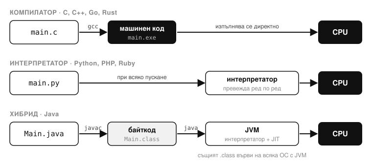
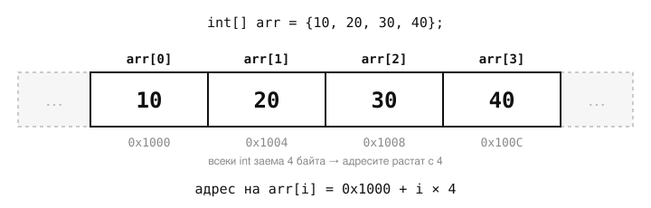
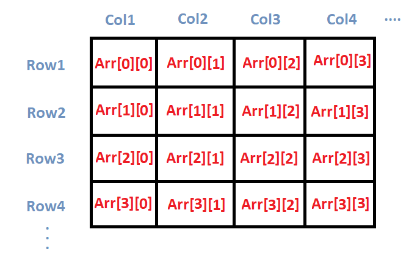
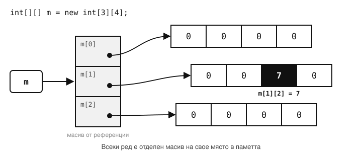

### 23/10/2026 

---

### 1. Променливи и управляващи конструкции

* **Променлива:** Именувано място в паметта на компютъра, в което се съхраняват данни.


* **Декларация:** Обявяване на променливата и нейния тип данни преди използването ѝ (заделяне на памет).


* **Инициализация:** Задаване на първоначална стойност на променливата или обекта.


* **Присвояване:** Задаване на стойност на променливата.


* **Идентификатор:** Име, което се дава на променлива, клас или метод.

> [!TIP]
> ```java
> int age;          // декларация
> age = 17;         // присвояване (първата стойност = инициализация)
> int grade = 11;   // декларация + инициализация на един ред
> grade = 12;       // ново присвояване
> ```
>
> Тук `age` и `grade` са идентификатори. Правила в Java: започват с буква, `_` или `$`; без интервали; не може да са ключова дума (`int`, `class`…); малки и главни букви се различават — `age` и `Age` са различни имена.


---

### 2. Типове данни

* **Примитивни типове:** Базови градивни блокове в програмирането за съхранение на единични стойности в паметта.


  * `int`: За цели числа.


  * `float` / `double`: За реални числа (десетични стойности; `float` заема 4 байта с ~7 знака точност, а `double` заема 8 байта с ~15–16 знака).


  * `char`: За единични символи (позволява математически операции чрез ASCII стойностите си).


  * `boolean` / `bool`: За логически стойности (`true`/`false`, представяни от машината като 1 и 0).

> [!TIP]
> Всички 8 примитивни типа в Java:
>
> | Тип | Размер | Пример |
> |---|---|---|
> | `byte` | 1 байт | `byte b = 100;` (от −128 до 127) |
> | `short` | 2 байта | `short s = 30000;` |
> | `int` | 4 байта | `int i = 2_000_000_000;` (до ~2.1 млрд) |
> | `long` | 8 байта | `long l = 10_000_000_000L;` |
> | `float` | 4 байта | `float f = 3.14f;` |
> | `double` | 8 байта | `double d = 3.14;` |
> | `char` | 2 байта | `char c = 'A';` |
> | `boolean` | — | `boolean ok = true;` |
>
> ```java
> char c = 'A';
> System.out.println((int) c);          // 65
> System.out.println((char) (c + 2));   // C
> System.out.println(0.1 + 0.2);        // 0.30000000000000004 — точността е ограничена
> ```

> [!NOTE]
> В Java `boolean` не е число: `boolean b = 1;` и `if (1)` са грешки (в C/C++ са позволени). Стойностите са само `true` и `false`.


* **Референтни типове:** Включват типа `String` (за текст), масиви и класове (започват с главна буква в Java/C#).


---

### 3. Транслация и изпълнение на кода

* **Компилатор:** Превежда целия програмен код до машинен код наведнъж, преди програмата да бъде изпълнена (напр. C, C++, Go, Rust).


* **Интерпретатор:** Превежда и изпълнява програмния код последователно по време на самото му изпълнение (напр. Python, PHP, Ruby).


* **Хибридни езици (Java):** Компилират изходния код до байткод (Bytecode), който след това се изпълнява от интерпретатора на виртуалната машина (JVM).



> [!TIP]
> ```bash
> javac Main.java   # компилира → Main.class (байткод)
> java Main         # JVM изпълнява байткода
> ```
>
> Байткодът е еднакъв за всяка операционна система — един и същ `Main.class` върви на Windows, Linux и macOS, стига да има JVM.

> [!NOTE]
> JVM не само интерпретира: части от кода, които се изпълняват често, се компилират „в движение“ до машинен код от **JIT компилатора** (Just-In-Time). Затова Java е много по-бърза от чисто интерпретируемите езици.


---

### 4. Памет и масиви

* **Структура на RAM паметта:** Физически оперативната памет е непрекъснат поток от байтове (клетки с адреси в шестнадесетична система) — в нея няма реални многомерни структури.


* **Едномерни масиви:** Последователност от елементи с общ тип и пряк достъп чрез индекс (индексирането започва от 0).



> [!TIP]
> Индексът всъщност е „колко елемента да прескочиш от началото“ — затова първият е `[0]`. Адресът се смята с една формула, така че `arr[0]` и `arr[999]` се достъпват еднакво бързо.
>
> ```java
> int[] arr = {10, 20, 30, 40};
> System.out.println(arr[0]);       // 10
> System.out.println(arr.length);   // 4
> System.out.println(arr[4]);       // ✗ ArrayIndexOutOfBoundsException
> ```


* **Двумерни масиви (Матрици):** Логическа абстракция (редове и колони) над едномерната памет за целите на математически задачи и алгебра. Тоест има масиви в масив.





> [!TIP]
> ```java
> int[][] m = new int[3][4];          // 3 реда, 4 колони
> m[1][2] = 7;                        // ред 1, колона 2
> System.out.println(m.length);       // 3 — броят редове
> System.out.println(m[0].length);    // 4 — броят колони
> ```
>
> Понеже всеки ред е отделен масив, в Java редовете може да са с различна дължина (*jagged array*): `int[][] j = { {1}, {2, 3}, {4, 5, 6} };`


---

### 5. Обектно-ориентирано програмиране (ООП)

* **Клас:** Шаблон, описание и абстрактен тип данни, по който се създават обекти.


* **Обект:** Конкретен екземпляр от даден клас.


* **Състояние:** Данните и стойностите на полетата на обекта в даден момент.


* **Конструктор:** Специален метод за изграждане и инициализиране на обекти чрез оператора `new`.


* **Дефолтен конструктор:** Наследява се автоматично от базовия клас `Object` и инициализира полетата със служебни стойности по подразбиране (`null`, `0`, `false`).


* **Конструктор с параметри:** Изрично дефиниран конструктор за инициализация с конкретни стойности (замества и скрива дефолтния).

> [!NOTE]
> Конструкторите в Java **не се наследяват**. Ако в класа няма нито един конструктор, **компилаторът сам добавя** празен конструктор без параметри — той извиква конструктора на родителя (в крайна сметка на `Object`). Полетата получават `null`, `0`, `false` още при заделянето на паметта с `new`.


* **Ключова дума `this`:** Указател/референция към самия текущ обект (спестява дублирането на имена на променливи в пространството от имена).

> [!TIP]
> Всичко от тази част на едно място:
>
> ```java
> public class Student {
>     String name;    // полета → състоянието на обекта
>     int grade;
>
>     // конструктор с параметри
>     public Student(String name, int grade) {
>         this.name = name;     // this.name → полето, name → параметъра
>         this.grade = grade;
>     }
> }
>
> Student ivan = new Student("Иван", 11);   // обект — конкретен екземпляр
> Student empty = new Student();            // ✗ грешка — дефолтният конструктор вече го няма
> ```
>
> Ако искаш и празен конструктор, напиши го изрично: `public Student() {}`.
